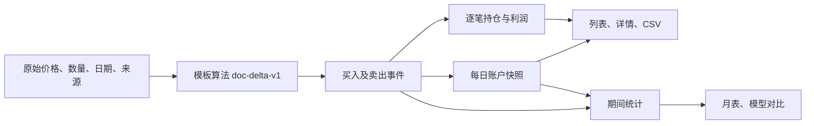

# 交易记录 UI 取值逻辑设计

日期：2026-11-11。状态：取值设计已接入 UI，新版计算为 doc-delta-v1。模板核验与正式行情来源隔离，Pages发布由本轮用户明确授权。

依据：[完整数据流程以及计算公式.md](完整数据流程以及计算公式.md)。验收对象：V1 原始、第一名、D1，2026-11-02 至 11-04 的三天示例。

**本轮用户已明确：62.69−61.72=0.97，在本模型中收益率就是 0.97%。本设计完整采用这一业务定义。** 价格差的数值作为百分数，再除以 100 参与金额计算。以下不使用旧账本的价格比值收益率，也不把原始价格直接乘数量替换模板规定的卖出回款。

## 1. 最终应得到什么

| 日期收盘 | 账户现金 | 模板口径持仓金额 | 当日总资产变化 | 收盘总资产 |
|---|---:|---:|---:|---:|
| 11-02 | 21,484.0000 | 万邦 18,695.6052 | +179.6052 | 40,179.6052 |
| 11-03 | 19,556.0563 | 襄阳 19,979.6850 | −643.8639 | 39,535.7413 |
| 11-04 | 19,985.7413 | 百洋 19,475.7100 | −74.2900 | 39,461.4513 |

截至示例结束：万邦已实现利润 −533.9437，襄阳校验结算利润 +69.6850，百洋浮动利润 −74.2900，合计 −538.5487；40,000−538.5487=39,461.4513。

“持仓金额”在本文指模板计算的持仓价值。即使有报价，也不能用“报价×数量”覆盖这个值。本例数量 300/1000/1700 按原文乘法参与计算；若 UI 使用股票标准数量单位，应显示为 300 股（3 手）、1000 股（10 手）、1700 股（17 手），不能额外再乘 100。

## 2. 现有 UI 的问题及修改方向

对照本机 `/api/v3/ledger?model=original&rank=1&mode=D1`、`lib/v3_ledger.py` 和 `templates/v3-dashboard.js`：

| 当前取值 | 为什么与本轮模板不一致 | 本版设计 |
|---|---|---|
| `raw=(卖价/买价−1)×100` | 与用户确认的“价差数值就是百分数”不同 | 独立 `return_pct=卖价−买价`，作为百分数使用 |
| `proceeds=数量×卖价` | 覆盖了模板“分摊持仓金额＋分批盈亏”的回款算法 | 回款由本版结算事件生成，禁止沿用旧值 |
| `profit=数量×价差` | 与模板的前日持仓结转、分批利润定义不同 | 分批利润＝分批回款−分摊初始买入成本 |
| `capital` 用当日开盘估值 | 模板期初总资产承接前日收盘 | 单独保存期初资产，不再混同开盘时点估值 |
| `positionAmount` 随卖出减至零 | 历史“买入持仓金额”会变成零 | 初始买入成本冻结；剩余持仓价值另存 |
| `cashAmount=reserve+saleAmount` | 这是本笔额度追踪值，不能解释成账户现金或额度余款 | 预算余款、累计回款、账户现金三个字段分开 |
| `ending=reserve+saleAmount` | 清仓后本笔追踪值被称作“收盘后金额” | 收盘总资产只来自该日账户收盘快照 |
| 总金额卡取最新快照，可用金额卡取筛选内最近买入行 | 两张卡可能不是同一天或同一时点 | 资产和现金卡使用同一个快照 ID |
| 逐笔按买入日汇总，月表按卖出日汇总 | 跨月时同名“利润”可能来自不同范围 | 明确交易归属与会计期间；标题和接口返回统计依据 |

修改前旧版回放得到襄阳 900 股、百洋 1600 股；本模板为 1000/1700。原因不只是显示小数位，而是收益、期初资产、预算及结算规则均不同。不能只换前端表头，继续复用旧版资金快照。

## 3. 一套输入、一个计算版本、三类结果



- **输入层**只存事实或明确的示例假设，不存旧 UI 已经算错的本金、收益和汇总金额作为计算依据。
- **计算层**统一使用 `calc_version=doc-delta-v1`，金额使用 Decimal。
- **交易结果**回答“这只股票投入多少、某批卖出多少、赚亏多少”。
- **账户快照**回答“这个时点全账户有多少现金、持仓和总资产”。
- **期间统计**回答“这个月发生了多少已实现利润、浮动利润变化和资产变化”。

旧版 `shares-v1-20261111` 与新版结果不能拼接。缓存、API、CSV、月表、模型对比必须携带同一 `calc_version`、`source_mode`、账户标识和数据截止时点。

## 4. 统一字段与公式

### 4.1 买入、预算和现金

记期初总资产为 E，买入前账户现金为 C，策略可用现金为 F，半仓额度为 L，买入价为 B，数量为 Q，买入支付为 M。

```text
期初总资产 E = 前一交易日收盘总资产；新账期首日采用初始资金
半仓目标额度 L = E × 50%
实际下单上限 = min(F, L)
可买数量 Q = floor(实际下单上限 / (B × 100)) × 100
实际买入支付 M = B × Q
半仓额度未用部分 U = L − M
买入后账户现金 = 买入前账户现金 C − M
```

本例 11-03 的 L=20,089.5 是原文明确给定输入，保存 `budget_source=template_given`。如果纯按 40,179.6052÷2 自动计算，会是 20,089.8026；不能为了凑样例，在整个系统暗加“期初资产先截整数”的规则。本例按明确输入验收，数量仍为 1000，U=179.5。

11-04 的半仓目标额度为 39,535.7413÷2=19,767.87065，U=217.87065。若当日开盘先买百洋，原有现金 19,556.0563 仍足以支付 19,550，因此即使卖出回款按既有策略暂锁，也能买 1700 股。**额度未用部分 U 与实际下单上限的未用部分是两个不同值。**

资金是否锁定沿用明确的策略规则并单独保存；锁定资金仍属于账户现金，只不计入 F。不能把全部现金、可用现金、半仓额度写进同一个字段。

### 4.2 未卖出时的收盘利润和持仓金额

记收盘价为 Pclose，初始实际买入成本为 M。

```text
收盘收益率（百分数） rclose = Pclose − B
收盘浮动利润 UPL = M × rclose / 100
收盘持仓金额 Vclose = M + UPL
账户收盘总资产 = 账户收盘现金 + 全部未卖出持仓的模板价值
```

同一成本、同一收盘价只计算一次。不能在已经包含浮盈的 Vclose 上，再重复加同一收盘利润。部分卖出后的收盘估值，只对剩余数量对应的初始成本计算。

### 4.3 分批卖出：整批盈亏、分批盈亏、分批利润

以下为万邦使用的模板分批结算方式。记前日收盘持仓金额为 Vprev，该日开始时剩余数量为 Qprev，本批卖出数量为 q，实际报价为 S，本批分摊初始买入成本为 K。

```text
本批收益率（百分数） r = S − B
整批盈亏 WholePnl = 初始买入成本 M × r / 100
本批分摊前日持仓金额 A = Vprev × q / Qprev
本批分摊初始成本 K = 初始买入成本 M × q / 初始数量 Q
分批盈亏 BatchChange = A × r / 100
分批回款 Proceeds = A + BatchChange
分批利润 RealizedProfit = Proceeds − K
```

等价分解：`分批利润＝本批分摊前日浮动利润＋分批盈亏`。因此“分批盈亏”和“分批利润”不是同一个数。

万邦同一天两批均使用 11-02 收盘基准；早盘分摊后，午盘使用基准剩余部分。不能午盘又用全笔 Vprev 计算，也不能把早盘回款计入午盘持仓基数。

`WholePnl` 是假设整笔都按该时点报价结算的分析指标，**不入现金账**。实际现金账只记录 `Proceeds`；实际实现利润只记录 `RealizedProfit`。不能把两批整批盈亏相加当真实利润。

### 4.4 襄阳整笔“按收盘持仓金额结算”的特殊输入

原文没有 11-04 真实卖价和分批时点，明确用 11-03 收盘价 20.26 及对应持仓金额 19,979.685 做闭环校验。因此该条保存：

```text
settlement_mode = close_snapshot_cashout
price_source = template_validation_previous_close
实际9:35/13:35卖价及卖出时间 = null
回款 = 指定的前日收盘持仓金额 = 19,979.685
实现利润 = 回款 − 初始成本 = 69.685
```

这里不能再次对 19,979.685 乘 0.35% 加利润，也不能改成 20.26×1000=20,260。本例“分批盈亏”汇总按原文作为整笔结算盈亏 69.685 展示，早午分批字段均不适用。

这一条是**文档校验输入**，不是已经获取到 11-04 真实卖点。正式行情模式缺真实成交依据时保留待确认，不能自动拿前日收盘替代所有缺失卖价。两种来源必须分开。

### 4.5 部分卖出、剩余持仓、顺延

- 剩余数量＝初始数量−已成交卖出数量；未成交报价不会减少数量或增加回款。
- 初始买入成本 M 永久保存；剩余原始成本＝M×剩余数量/Q。
- 盘中未重新估值时，剩余结转持仓＝该日基准 Vprev−当天已分摊金额；收盘再按剩余初始成本及当日收盘收益率计算，不对同一收益重复累计。
- 顺延至下一交易日仍保留原买入价和成本；该日的前日持仓基准与剩余数量均显式存档，已卖批次不重复执行。
- 奇数手按实际数量分摊。万邦 300 股早盘 100、午盘 200，对应 1/3、2/3，不能强制各 50%。既有拆批判断仍以对应卖出日 9:35 相对昨收的方向为依据。
- 缺价、涨跌停、停牌、尚未到时点、该批不安排卖出分别保存状态，不能统一写成 0 元成交。

## 5. 三天完整核对

### 5.1 数据1：11-02 买入万邦

| 字段 | 数值 | 取值 |
|---|---:|---|
| 期初总资产 | 40,000 | 新账期初始化 |
| 半仓额度 | 20,000 | 40,000÷2 |
| 买入价、数量 | 61.72；300 | 文档输入 |
| 买入支付/初始持仓成本 | 18,516 | 61.72×300 |
| 额度余款 | 1,484 | 20,000−18,516 |
| 买入后账户现金 | 21,484 | 40,000−18,516 |
| 收盘价、收益率 | 62.69；0.97% | 价差数值作为百分数 |
| 收盘浮动利润 | 179.6052 | 18,516×0.97÷100 |
| 收盘持仓金额 | 18,695.6052 | 初始成本＋浮动利润 |
| 收盘总资产 | 40,179.6052 | 21,484＋18,695.6052 |

9:35/13:35 卖价及其整批、分批字段均为“— / 当日未卖”。已实现利润为 0，分批盈亏汇总为 0；若保留原文“分批利润”列，则显示 **179.6052〔浮动〕**，不能标成已实现。

### 5.2 数据2：11-03 万邦分批卖出

| 字段 | 9:35 | 13:35 | 合计 |
|---|---:|---:|---:|
| 卖出价 | 59.43 | 57.14 | — |
| 卖出数量 | 100 | 200 | 300 |
| 收益率 | −2.29% | −4.58% | 不相加冒充整笔收益率 |
| 整批盈亏（分析金额） | −424.0164 | −848.0328 | 不相加 |
| 分摊前日持仓金额 | 6,231.8684 | 12,463.7368 | 18,695.6052 |
| 分摊初始买入成本 | 6,172 | 12,344 | 18,516 |
| 分批盈亏 | −142.7098 | −570.8391 | −713.5489 |
| 实际回款 | 6,089.1586 | 11,892.8977 | 17,982.0563 |
| 分批利润 | −82.8414 | −451.1023 | −533.9437 |
| 万邦剩余数量 | 200 | 0 | — |
| 万邦剩余结转持仓 | 12,463.7368 | 0 | — |

“前日利润＋当前时点变化”的整批分析公式可保留：179.6052＋(59.43−62.69)×18,516÷100=−424.0164。该分析值与实际分批回款、分批利润各自存储。

### 5.3 数据2：11-03 新买襄阳并收盘

| 字段 | 数值 |
|---|---:|
| 期初总资产 | 40,179.6052 |
| 给定半仓额度 | 20,089.5 |
| 买入价、数量 | 19.91；1000 |
| 买入支付 | 19,910 |
| 额度余款 | 179.5 |
| 当日所有买卖完成后账户现金 | 19,556.0563 |
| 收盘价、收益率 | 20.26；0.35% |
| 襄阳浮动利润 | 69.6850 |
| 襄阳收盘持仓金额 | 19,979.6850 |
| 收盘总资产 | 39,535.7413 |

账户现金由 `21,484−19,910＋6,089.1586＋11,892.8977` 得到，不能拿“襄阳额度余款179.5＋万邦回款”替代。

### 5.4 数据3：11-04 襄阳校验结算并买百洋

| 字段 | 数值 |
|---|---:|
| 期初总资产 | 39,535.7413 |
| 襄阳结算回款（校验输入） | 19,979.6850 |
| 襄阳实现利润 | 69.6850 |
| 百洋半仓目标额度 | 19,767.87065 |
| 百洋买入价、数量 | 11.50；1700 |
| 百洋买入支付 | 19,550 |
| 百洋额度余款 | 217.87065 |
| 当日买卖完成后账户现金 | 19,985.7413 |
| 百洋收盘价、收益率 | 11.12；−0.38% |
| 百洋收盘浮动利润 | −74.2900 |
| 百洋收盘持仓金额 | 19,475.7100 |
| 收盘总资产 | 39,461.4513 |

现金核对：19,556.0563＋19,979.6850−19,550=19,985.7413。217.87065 只说明半仓额度没有全部用掉，不能再次加到账户现金。

### 5.5 原文演示顺序与真实时间顺序

原文先列“卖旧仓子流程”，再列“买新仓子流程”，便于核对；它不证明当天开盘买入发生在 13:35 卖出以后。

若 11-03 襄阳开盘买入先入账，各时点账户现金应为：

| 时点 | 全账户现金 | 持仓组成（沿模板基准） | 总资产 |
|---|---:|---|---:|
| 襄阳买入后 | 1,574.0000 | 万邦18,695.6052＋襄阳19,910 | 40,179.6052 |
| 万邦9:35卖出后 | 7,663.1586 | 万邦12,463.7368＋襄阳19,910 | 40,036.8954 |
| 万邦13:35卖出后 | 19,556.0563 | 襄阳19,910 | 39,466.0563 |
| 襄阳收盘估值后 | 19,556.0563 | 襄阳19,979.6850 | 39,535.7413 |

原文 27,573.1586/39,466.0563 的现金值，是“尚未扣襄阳买入支出”的演示步骤。UI 可以在计算过程里保留这些步骤，但不能把它们同时标为包含襄阳买入后的账户实时现金。11-04 襄阳结算时刻原文未知，必须保存为空，不能编造9:35或13:35成交。

## 6. UI 各字段具体取值

### 6.1 列表：保留分组，消除金额重名

| 当前/建议字段 | 新字段 | 范围及时点 | 取值规则 |
|---|---|---|---|
| 日期 | `buy_date` | 本笔 | 实际/模拟买入所属交易日，另保留信号日 |
| 分值、名称、板块 | 原身份字段 | 本笔 | 同模型、同股票、同信号日的原始资料 |
| 开盘价 | `open_price` | 报价 | 原 D0 开盘行情；不替代其他模式实际买入价 |
| 当日总金额 → 期初总资产 | `day_open_equity` | 账户，日初 | 前日收盘快照；本例为40000/40179.6052/39535.7413 |
| 当日可用金额 → 买入前可用现金 | `cash_available_before_buy` | 账户，买入前 | 账户现金减策略锁定资金，不直接显示半仓额度 |
| 新增/明示半仓额度 | `buy_budget_target` | 本笔预算 | E÷2或明确给定值；标来源 |
| 持仓金额 → 买入持仓金额 | `initial_buy_cost` | 本笔，买入后冻结 | B×Q，卖完后仍保留18516/19910/19550 |
| 未持仓金额 → 额度余款 | `budget_remainder` | 本笔，买入后冻结 | 半仓目标额度−初始买入支付；不加回款 |
| 9:35卖价 | `am.price` | 本批实际日期 | 只读该批有效报价，显示实际卖出日及状态 |
| 9:35整批盈亏 | `am.whole_pnl_amount` | 本笔分析 | M×(S−B)÷100，单位元 |
| 9:35分批盈亏 | `am.batch_change` | 本批 | 分摊前日持仓金额×(S−B)÷100，单位元 |
| 9:35分批利润 | `am.realized_profit` | 本批 | 本批回款−本批初始成本，单位元 |
| 13:35四字段 | `pm.*` | 本批实际日期 | 与早盘同契约；不借13:15或其他日期报价 |
| 分批盈亏 | `batch_change_total` | 已结算批次 | 两批BatchChange之和；整笔校验结算按明确模式展示 |
| 分批利润 | `display_profit` | 本笔截至选定时点 | 已实现利润＋剩余浮动利润；标“浮动/已实现/含浮动” |
| 卖出金额 → 累计回款 | `sale_proceeds_total` | 本笔截至选定时点 | ΣProceeds，包含分摊成本；不能当净利润 |
| 收盘后金额 → 买入日收盘总资产 | `buy_day_close_equity` | 账户，该买入日收盘 | 对应日期收盘快照；不取本笔预算余款＋回款 |

列表三个“盈亏/利润”金额列统一用“元”。若同时展示百分比，增加明确的“整批收益率”次级信息，不能把 −424.0164 后面加 `%`。文档中的收益率 −2.29% 与整批盈亏 −424.0164 元同时保留。

持仓详情再展示 `remaining_quantity`、`remaining_original_cost`、`remaining_position_value`、`unrealized_profit`、`realized_profit_total`、`as_of`。不能把“买入持仓金额”“剩余成本”“含浮动利润的持仓价值”合并成一个可变字段。

同一行的买入资金组是历史快照，卖出组是截至选定截止时点的交易结果；表头分组和实际卖出日期必须说明这一点。未来批次不得提前显示为成交。

### 6.2 顶部概览卡

建议延续7张卡的现有布局，改为：

1. 最近买入标的：所选模型、名次、D1范围内最近有效买入；空占位和未买入记录不冒充买入。
2. 截至所选期末总资产：同一账户、同一截止快照的现金＋模板持仓价值。
3. 截至所选期末可用现金：同一个快照的可用现金；次级展示账户现金及锁定资金。
4. 本期资产盈亏：期末总资产−期初总资产−净入出金。
5. 本期已实现利润：按本期真实/示例结算事件日期汇总；不混入浮动利润。
6. 9:35分批利润：本期早盘事件实现利润之和。
7. 13:35分批利润：本期午盘事件实现利润之和。

“整笔按收盘校验结算”的利润归入本期已实现利润，但不强分到早盘或午盘；详情中列为其他结算。因此本期已实现利润＝早盘＋午盘＋其他结算。

历史月份使用历史截止快照；当月使用当前已发生时点的快照。搜索股票只过滤交易列表，不改变全账户资产卡，卡片明确账户范围。若保留“所选交易分批盈亏累计”，必须用该名称，不能冒充账户收益率。

### 6.3 分批利润列的状态，避免浮盈误称实盈

| 本笔状态 | 分批盈亏汇总 | 分批利润展示 | 会计字段 |
|---|---:|---|---|
| 已买未卖 | 0 | 浮动利润，附“浮动” | realized=0；unrealized有值 |
| 部分卖出 | 已卖批次分批盈亏 | 已实现＋剩余浮动，附“含浮动” | 两项独立保存 |
| 全部卖出 | 已卖批次分批盈亏 | 已实现利润，附“已实现” | unrealized=0 |
| 未买入 | — | — | 不制造交易利润 |
| 持仓有但估值缺失 | 已实现部分仍可展示 | 总利润—，提示浮动部分缺估值 | 不把缺估值当0 |

这样既能复现数据1“179.6052（浮动）”，又不会把这笔浮盈在第二天实现时再计一次账户利润。

## 7. 月表、汇总和模型对比

### 7.1 必须同时保存的四个期间指标

```text
本期已实现利润 R = 本期结算事件的实际利润之和
期末浮动利润 U_end = 期末所有未卖持仓的浮动利润之和
本期浮动变化 ΔU = U_end − U_start
本期资产盈亏 P = R + ΔU
期末总资产 = 期初总资产 + R + ΔU + 本期净入出金
```

本例日账：

| 日期 | 当日已实现利润 | 当日浮动变化 | 当日资产盈亏 | 期末累计浮动 |
|---|---:|---:|---:|---:|
| 11-02 | 0 | +179.6052 | +179.6052 | +179.6052 |
| 11-03 | −533.9437 | −109.9202 | −643.8639 | +69.6850 |
| 11-04 | +69.6850 | −143.9750 | −74.2900 | −74.2900 |
| 三天合计 | −464.2587 | −74.2900 | −538.5487 | −74.2900 |

这张表是月末资产闭环的核心。不能要求“期末资产＝期初资产＋已实现利润”，也不能把每天累计浮盈直接求和。

### 7.2 月表建议字段

月份、月初总资产、早盘分批盈亏金额、早盘已实现利润、午盘分批盈亏金额、午盘已实现利润、其他结算利润、已实现利润合计、浮动利润变化、本月资产盈亏、月末账户现金、月末持仓金额、月末总资产。

原先的百分比分析列如果保留，独立写明“收益率分析”，不能与金额列共用字段。不同成本的股票收益率相加，不代表账户收益率。账户期间收益率单独取 `本期资产盈亏÷期初总资产×100`；存在中途资金调整的期间另行分段，不能跨4万重置点直接计算一个比例。

本例三天账户收益率为 −538.5487÷40000×100=−1.34637175%，显示 −1.35%。

### 7.3 日期、筛选与汇总

- 明细保留按买入日选交易；明细底部只能叫“所选买入交易，截至X的结果汇总”，不能当本月结算总利润。
- 月表、账户概览和模型对比按结算事件实际/示例日期统计，使用完全相同的 `PeriodStats`。
- 跨月买入、次月卖出：成本仍在原交易，已实现利润归结算月；前月月末持仓价值承接后月期初。不得把整笔最终利润回填成前月利润。
- 本金、现金余额、持仓余额、期初资产、期末资产不求和；买入支付、回款、已实现利润等流量可以按明确期间求和。
- 同日多只股票只能取一个账户收盘快照，不能把各行重复的账户总资产相加。
- 2026年11月4万元仍为独立账期初始资金；旧10万元账期尾部回款不混入。D1与D2、模型、名次独立。本轮先验收指定的V1原始第一名D1样例，其他账户上线时必须显式选新版，不能局部混算。

模型比较继续18条统计线；相同账户、截止时间、计算版本和区间时，各项金额必须与月表一致。默认按同口径已实现利润排名，并展示浮动变化和资产盈亏供对照，不能用整批假设盈亏排名。

## 8. 精度与空值

- 输入价格按原文精度存 Decimal；百分数0.97计算时使用0.0097。
- 本模板买入成本按数量×买价；分摊基准及实际入账盈亏/回款按4位小数、ROUND_HALF_UP生成。最后一批分摊取基准剩余值，防止舍入后分摊总额不守恒。
- 预算保留除法产生的精度，例如19767.87065；预算余款也保留该精度，不强行压成2位。
- 实际入账现金、持仓和利润保留4位；UI显示2位，展开计算显示4位，预算必要时显示5位。不要用格式化后的字符串反算账本。
- 上述4位入账用于**精确复现模板检查点**。例如两笔万邦分批盈亏先入账为−142.7098/−570.8391，回款合计17982.0563。如果改成无限精度中间计算、只在最终显示时取整，隐藏小数会与模板略有差别，必须换版本，不能暗改。
- `null`表示缺依据/不适用；0表示确实没有已实现利润、已清仓或真实零值。另存`status`区分缺价与不适用。
- 不含未给定的税费；若后续配置税费，另设费用事件，不能藏进价差或回款。

## 9. API 数据契约与落点

### 9.1 交易对象

```json
{
  "calc_version": "doc-delta-v1",
  "source_mode": "template",
  "account_key": "original:1:D1:2026-second",
  "trade_key": "stock:2060:2026-11-02:301520:D1",
  "buy_date": "2026-11-02",
  "initial_buy_cost": "18516.0000",
  "buy_budget_target": "20000",
  "budget_remainder": "1484",
  "quantity": 300,
  "am": {
    "date": "2026-11-03",
    "price": "59.43",
    "quantity": 100,
    "return_pct": "-2.29",
    "whole_pnl_amount": "-424.0164",
    "allocated_carry_value": "6231.8684",
    "allocated_initial_cost": "6172.0000",
    "batch_change": "-142.7098",
    "proceeds": "6089.1586",
    "realized_profit": "-82.8414",
    "settlement_mode": "carry_value_delta",
    "status": "settled"
  }
}
```

账户快照必须返回 `snapshot_id/date/time/as_of/cash_total/cash_available/cash_locked/position_value/unrealized_profit/equity`；交易对象另存 `buy_snapshot_id/buy_day_close_snapshot_id`。每个金额附明确范围，避免再次从最新交易行推断全账户余额。

期间对象返回 `opening_equity/closing_equity/realized_profit/unrealized_open/unrealized_close/unrealized_change/asset_pnl/net_capital_flow/am_profit/pm_profit/other_profit/date_basis/completeness`。模型对比和月表直接读该对象，不各自写公式。

### 9.2 数据来源隔离

样例 `source_mode=template` 读取原文输入：万邦59.43/57.14，襄阳20.26作为闭环校验结算，不用运行中行情覆盖样例。

正式 `source_mode=market` 使用带日期、时点及来源的有效报价，并使用同一新版算法。当前原交易文件万邦早盘记59.35，而本机分钟数据回放取59.43，必须保存具体采用来源和冲突信息。襄阳当前运行回放为11-04早盘19.17、午盘顺延11-05至19.77；不能混入模板，声称模板数据3已经有真实分批报价。原13:15不替代13:35，历史报价不借当前现价。

### 9.3 已接入的代码位置

| 位置 | 应做的改动 |
|---|---|
| `lib/v3_template_ledger.py` | 按本版公式生成持仓、结算、现金事件；保存不可变买入成本及日快照 |
| `lib/v3_ledger_service.py` | 输入来源、版本隔离、预算覆盖来源、完整度及缓存指纹 |
| `lib/v3_ui_api.py` | 输出新版DTO和统一期间统计，避免沿用旧字段隐式语义 |
| `templates/v3-dashboard.js` | 列与卡片只做映射和格式化，取消本地重复资金计算；修正金额/百分比单位 |
| `templates/v3-dashboard.css` | 沿用现有资金、早盘、午盘配色；状态标签清晰可见 |
| 页面CSV/静态快照适配 | 共享字段、单位、版本及截止时点；保持脱敏规则 |

现有原始trades、报价、result作为来源保留。先以三天模板fixture验收新计算，再接完整历史输入并输出差异；不要直接把旧衍生利润批量回写成新结果。

## 10. 验收清单

1. 0.97%的模型定义在所有页面、CSV和API一致，不能有页面偷偷用比值收益率。
2. 初始成本18516、19910、19550卖完后仍保留，不被剩余成本0覆盖。
3. 万邦两笔分批盈亏−142.7098/−570.8391、两笔分批利润−82.8414/−451.1023分别正确，不能串字段。
4. 万邦回款17982.0563；累计利润−533.9437；整批假设盈亏不入现金账。
5. 襄阳校验整笔回款19979.685，早午卖价空且标来源；不得再重复计0.35%。
6. 百洋额度余款217.87065不加到账户现金；最终现金19985.7413。
7. 三个收盘快照分别40179.6052、39535.7413、39461.4513；现金＋持仓＝总资产。
8. 最终已实现−464.2587＋浮动−74.2900＝−538.5487，与资产减少一致。
9. 实际时点现金与原文分段演示现金分开；同一个快照内不漏掉当日新买持仓。
10. 单边卖出、缺价、顺延、空占位、部分卖出保留真实状态；回款只确认一次，数量守恒。
11. 列表、7卡、手机、月表、18条比较和CSV均带同一版本与数据截止时间；跨月的交易归属和期间归属分别标明。
12. 已接入运行UI、月表、对比和CSV；正式行情不注入模板校验卖价，原始交易文件保留。71项Python、15项JS契约、36账户审计、桌面/手机/CSV及静态登录脱敏验证通过。

离线核对脚本及结果：`/Users/admin/stock_quant_select/workspace/reviews/交易看板取值设计/三日样例校验.py`、`三日样例校验结果.json`。

## 11. 实施与发布补记

- 正式数据采用同一模板算法读取实际报价；11-03襄阳自动半仓额度为20089.8026，模板核验的显式给定值仍为20089.5。两者的来源不会混用。
- 万邦两批金额与模板一致；襄阳正式行情仍按实际早午日期结算，未用文档20.26校验价覆盖。因而11-04真实行情模式的账户资产不强行等于模板假设结果。
- 所有金额由服务端Decimal生成，初始成本、额度余款、回款和账户快照分开。历史查询保留原买入日期，只按截止日投影持仓状态。
- Pages保存同一36账户账本，完整数据压缩后AES-GCM加密，公开数据不包含财务快照或交易明细；浏览器解密后读取同版统计。
